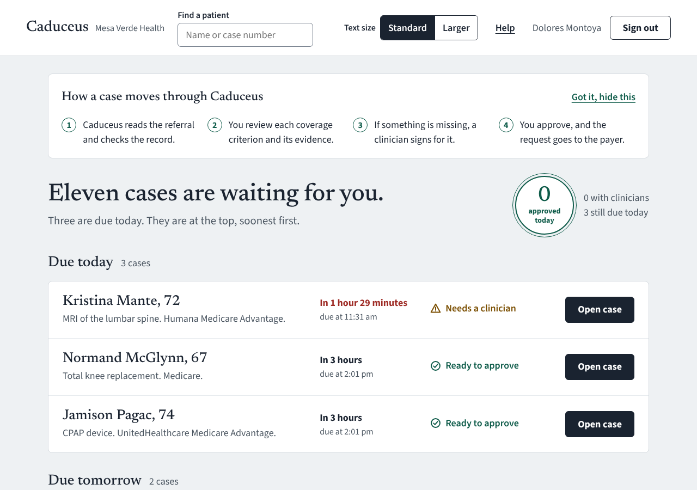
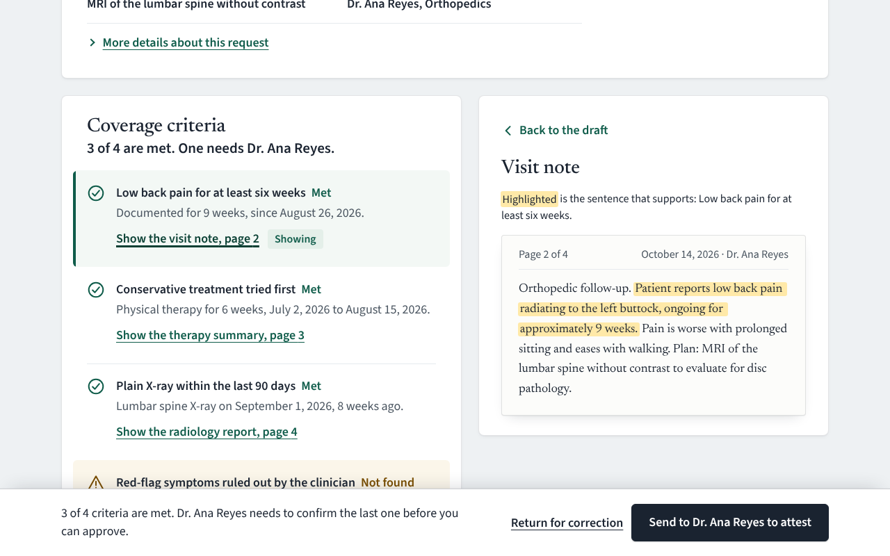
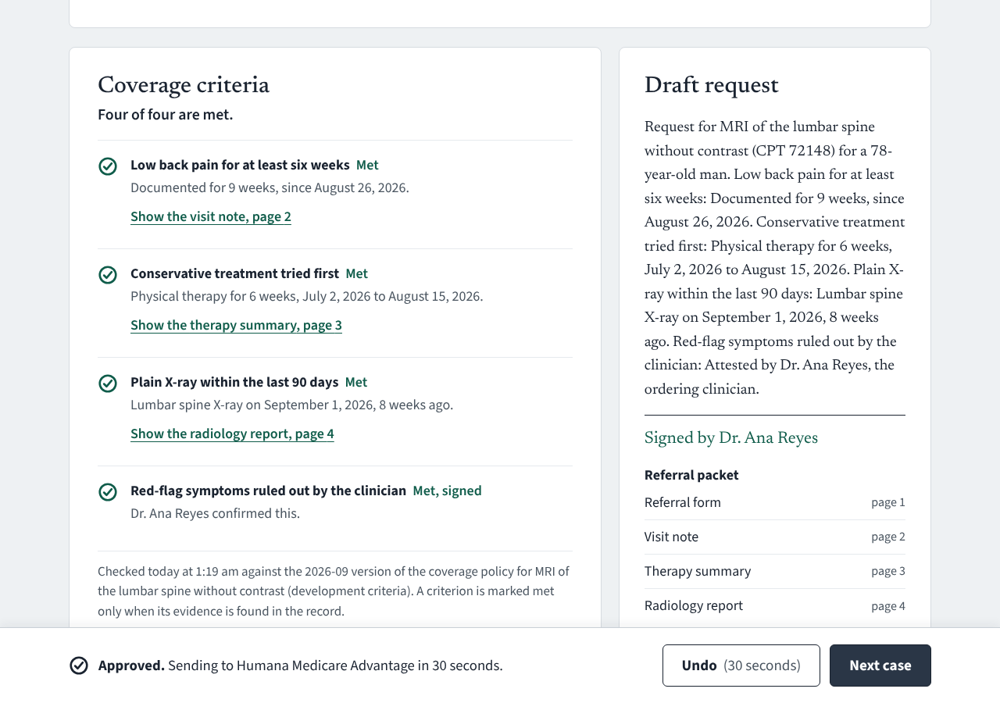
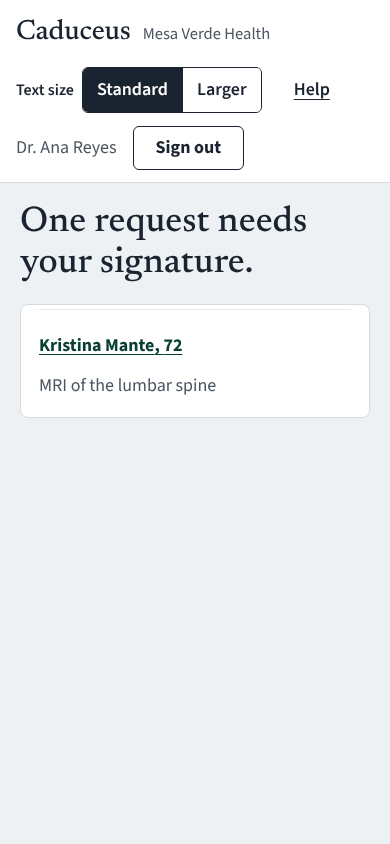

# Caduceus

A prior-authorization agent for a simulated six-clinic health system, Mesa Verde Health. It reads a referral,
checks the patient's record against the payer's coverage policy, drafts the request, and puts it in front of a
prior-authorization specialist with the evidence for every criterion. Anything the record does not answer goes to
the ordering clinician to confirm from their phone. Nothing reaches the payer until a person approves, and for
30 seconds after that they can still undo.

It is a portfolio project for forward-deployed engineering. Every patient is synthetic (Synthea), and the
interesting parts are the ones a real deployment would be judged on: where PHI may go, how a decision can be
audited, and whether the people who use it every day can.

| Queue | Evidence for a criterion |
|---|---|
|  |  |

| Approved, with undo | The clinician's phone |
|---|---|
|  |  |

## What is built, and how it is checked

| | | Checked by |
|---|---|---|
| **PHI-aware model router** | Identifiable work runs only on the in-VPC model, with no fallback. The external model accepts only HMAC-stamped, de-identified text, re-scanned before it leaves. | Tests for no-fallback, unstamped, forged and still-identifiable input; a leakage suite of 181 planted identifiers with 0 reaching the external wire |
| **Policy as code** | Coverage criteria are reviewed data, locked by content hash. A deterministic engine returns met, not met or unknown, with the sentence that supports each. Missing evidence is never "met". | Agreement with labels on 47 criteria across 11 cases: 1.00. Unknown reported as met: 0. Property tests |
| **Human in the loop** | Clinician attestation for unknowns; specialist approval required for submission; 30-second undo through an outbox; signing rewrites the draft but never overwrites a person's edit. | API tests for every path; submission without a recorded approval is refused |
| **MCP tool servers** | `ehr`, `documents`, `policies`, `tickets`, `payer`, with role checks and per-step allow-lists on the server side. | Red team: a note-borne injection, a tool called outside its step, a submit without approval, a forged stamp. 0 of 4 succeed |
| **Append-only audit log** | Hash-chained; the database refuses UPDATE and DELETE. | Tamper tests |
| **Review UI** | The "Attestation" design system: plain words, 18 px base text with a larger option, status always as icon plus word, red only when under two hours remain. | axe-core (WCAG 2.2 AA rules) on 11 screens with 0 violations; no sideways scroll at 320 px |
| **Eval gate** | `make evals` fails the build if agreement falls below 0.97, or if any unknown is reported as met, any identifier leaks, or any attack succeeds. | CI |
| **Reproducible data** | 11 scenarios built from Synthea with labels known by construction. | `make data` regenerates the dataset byte for byte; CI checks with `git diff --exit-code` |
| **Deployment** | Dockerfile, docker-compose (the model on an internal-only network), a Terraform skeleton for AWS. | Compose validated; Checkov 292 passed, 0 failed; Terraform not yet applied |

The 1.00 agreement measures that the engine does what its criteria say on cases built to known labels. It is not
a measure of clinical validity. That needs real policies, real charts and clinician reviewers.

## Public demo

The UI is served from Netlify and the API from Google Cloud Run, in a demo mode built for being public: synthetic
patients only, a banner that says so, resets every 6 hours, per-visitor rate limits, no model keys, and an API
that answers only requests Netlify has signed. See [docs/demo-deployment.md](docs/demo-deployment.md).

## Run it

Needs Python 3.12+ and Node 22.

```
make setup
make seed          # 11 demo cases, due times relative to now
make dev           # API on :8000, UI on http://localhost:5173
```

Sign in as **Dolores Montoya** (prior-authorization specialist) or **Dr. Ana Reyes** (ordering clinician; try
it at phone width). Development sign-in is on only when `CADUCEUS_AUTH_MODE=dev`; by default the service expects
OIDC bearer tokens and refuses to start without a de-identification key.

With Docker: `cp .env.example .env`, set `CADUCEUS_DEID_KEY`, then `docker compose up --build`. To have a local
model stand in for the in-VPC one, set `CADUCEUS_IN_VPC_URL=http://model:11434/v1` in `.env`, then run
`docker compose --profile llm run --rm model-pull` and `docker compose --profile llm up --build`. Without a model
configured, drafts come from a deterministic template and everything else works the same.

`make check` runs what CI runs: lint, 83 tests, the eval gate, and the end-to-end walk with accessibility checks.

## Layout

```
src/caduceus/
  router/       the only code that calls a model (ADR 1)
  deid/         Safe Harbor de-identification, stamping, re-identification
  criteria/     DSL, deterministic engine, approval lock (ADR 2)
  fhir/         patient records from local bundles or a FHIR server
  audit/        hash-chained, append-only log
  tools.py      tool gateway: role and workflow-step checks (ADR 3)
  mcp_servers.py  the same tools as MCP servers
  workflow.py   case state machine, outbox and undo (ADR 4)
  api.py        HTTP API for the UI; security headers; no-store on PHI
  evals/        criteria, leakage and red-team suites with gates
ui/             React review UI; e2e/ walks it in Chromium with axe-core
data/           synthetic patients, case overlays, criteria sets
infra/          Terraform skeleton, Postgres audit-log SQL
docs/           ADRs, data-handling note
```

## Security posture, in brief

Secure by default (OIDC unless development sign-in is asked for by name). PHI stays on the in-VPC route, and that
is enforced in types and tests. Responses that can carry PHI are `no-store`, with a strict Content Security
Policy. Patient names never enter URLs. The container runs as a non-root user on a read-only filesystem. The
audit log is append-only at the database level and archived under S3 Object Lock in the target deployment. See
[docs/data-handling.md](docs/data-handling.md) for what is PHI, where it flows, and the residual risk.

### Known vulnerabilities in dependencies

CI checks on every push and fails on any finding with a released fix. As of October 30, 2026:

| What | Scanner | Known vulnerabilities |
|---|---|---|
| Python packages (47, with dev tools) | pip-audit | 0 |
| UI packages (126, with build and test tools), Playwright | npm audit | 0 |
| Container image (Wolfi base, Python 3.13.18) | Grype | 2 medium, no fix released for Python 3.13 |
| Synthea, the data generator (never shipped), built from source with patched libraries | Grype | 0 (upstream's jar: 106) |

The two image findings are in CPython itself. CVE-2026-12345 (a `tempfile` cleanup race) is fixed upstream in
3.13.18, the version shipped; the scanner's data has not caught up. CVE-2025-15367 is in `poplib`, which
Caduceus never imports. Python and npm findings fail CI outright.

Upstream Synthea's published jar bundles old library versions with 106 known vulnerabilities (17 critical), so
`make data` builds Synthea from source with those libraries upgraded ([tools/synthea](tools/synthea)). The
dataset regenerates byte for byte with the patched build, which shows the upgrades did not change the
simulation. Synthea also runs with the network switched off (`scripts/offline.sh`), as a second line of defense.

## Not built yet

Fax intake with a vision-language model, and confidence routing (ADR 6). Hybrid retrieval over long packets
(ADR 5). The Postgres repository, then Temporal (ADR 4). OIDC sign-in in the UI: the API side is done and tested.
HAPI FHIR and Keycloak in compose. An AWS apply. Judge-scored draft quality. The full red-team corpus. A pended
case comes back to the queue with the payer's question; the mock payer does not deny yet, so there are no appeal
drafts.

## Decisions

[docs/adr](docs/adr): PHI-aware routing; policy as code; MCP as the integration boundary; state machine first,
Temporal later; hybrid retrieval (proposed); confidence routing (proposed).
