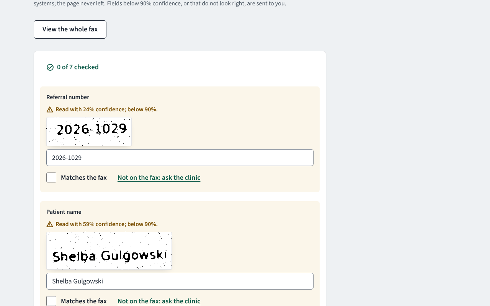
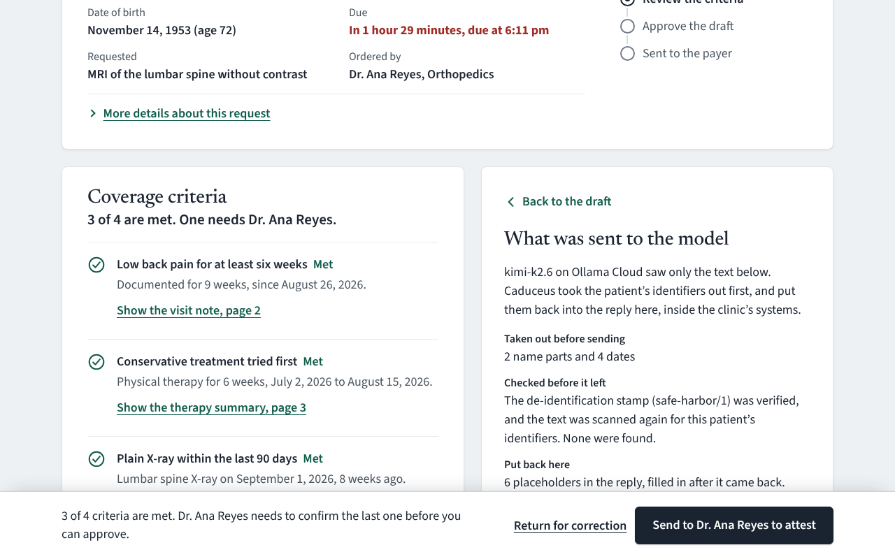
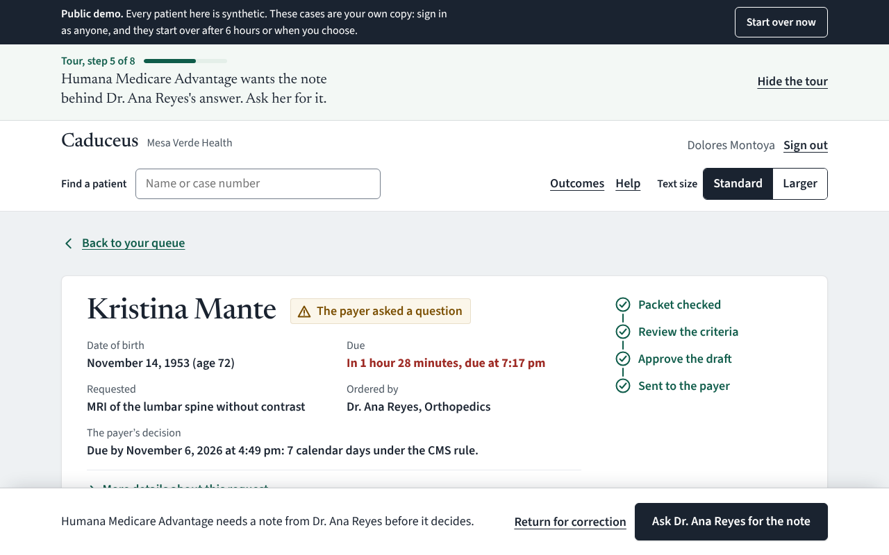
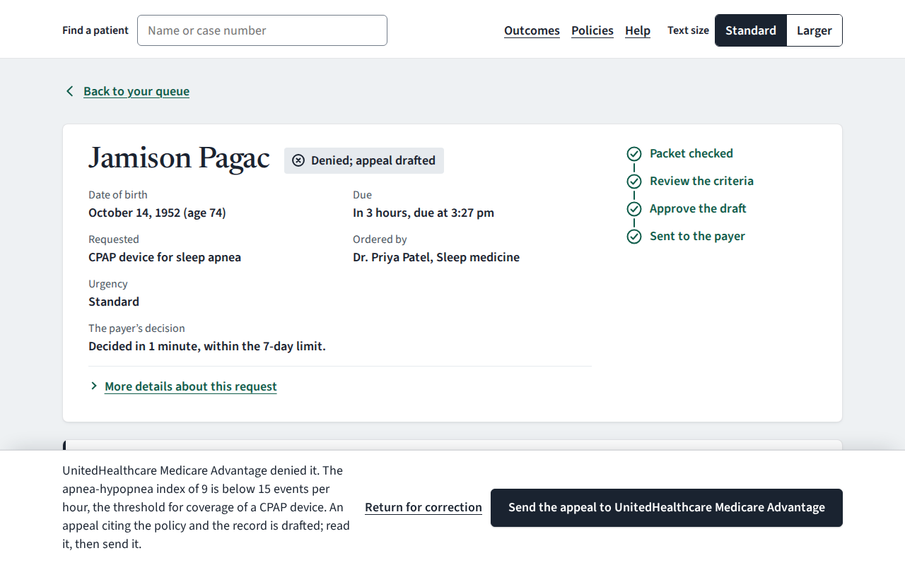
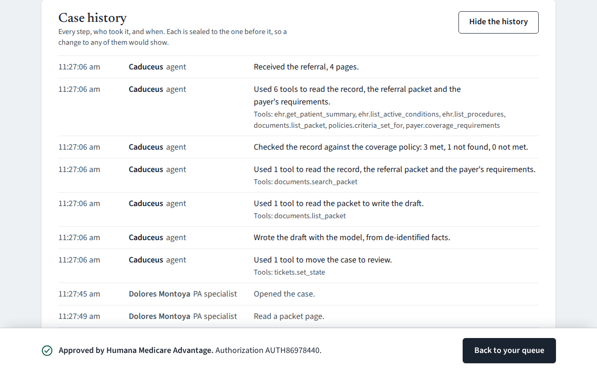
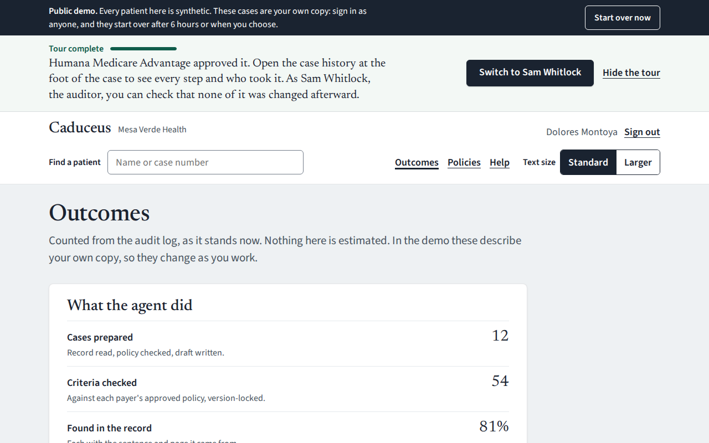

# Caduceus

A prior-authorization agent for a simulated six-clinic health system, Mesa Verde Health. It reads a referral,
checks the patient's record against the payer's coverage policy, drafts the request, and puts it in front of a
prior-authorization specialist with the evidence for every criterion. Anything the record does not answer goes to
the ordering clinician to confirm from their phone. Nothing reaches the payer until a person approves; for 30
seconds after that they can still undo, and until it is sent it can still be recalled.

It is a portfolio project for forward-deployed engineering. Every patient is synthetic (Synthea), and the
interesting parts are the ones a real deployment would be judged on: where PHI may go, how a decision can be
audited, and whether the people who use it every day can.

**[Try the live demo](https://caduceusdemo.netlify.app/)**. A guided tour follows one case from the referral to
the payer's approval, through a clinician's attestation, the payer's question and the clinician's note, and says
who to act as at each step. Your queue is your own copy, so nothing you do changes anyone else's. Then try the
faxed referrals, the denied CPAP request and its appeal, "See what was sent" under any draft, the case history,
and the outcomes page. [How it would roll out at a real health system](docs/rollout-plan.md).

**[Watch the 98-second walkthrough](https://caduceusdemo.netlify.app/demo.mp4)**: a faxed referral, the evidence,
the clinician's attestation, the payer's question and the clinician's note, a denial and its appeal, the audit trail.

| The queue, with referrals that arrived by fax | Checking a poor fax against the page |
|---|---|
|  |  |

| Evidence for a criterion | What was sent to the model |
|---|---|
|  |  |

| The payer asks a question | A denial, and the appeal drafted from the policy |
|---|---|
|  |  |

| The case history, sealed | Outcomes, counted from the audit log |
|---|---|
|  |  |

## What is built, and how it is checked

| | | Checked by |
|---|---|---|
| **PHI-aware model router** | Identifiable work runs only on the in-VPC model, with no fallback. The external model accepts only HMAC-stamped, de-identified text, re-scanned before it leaves. | Tests for no-fallback, unstamped, forged and still-identifiable input; a leakage suite of 181 planted identifiers with 0 reaching the external wire |
| **Policy as code** | Coverage criteria are reviewed data, locked by content hash. A deterministic engine returns met, not met or unknown, with the sentence that supports each. Missing evidence is never "met". | Agreement with labels on 47 criteria across 11 cases: 1.00. Unknown reported as met: 0. Property tests |
| **Human in the loop** | Clinician attestation for unknowns, with reminders at most every 10 minutes; specialist approval required for submission; 30-second undo through an outbox, then recall until it is sent; a returned case is prepared again when the clinic resubmits; signing rewrites the draft but never overwrites a person's edit. When the payer pends a request and asks for documentation, the clinician writes and signs the note in their own words (or says they cannot), and the reply goes through the same approval and outbox. | API tests for every path; a payer tool sends only what is waiting in the outbox under the approval that put it there, and refuses a note changed after approval |
| **MCP tool servers** | `ehr`, `documents`, `policies`, `tickets`, `payer`, with role checks and per-step allow-lists on the server side. | Red team: a note-borne injection, a tool called outside its step, a submit without approval, a forged stamp. 0 of 4 succeed |
| **Payer rules (CMS-0057-F)** | A coverage-requirements check at intake (CRD-style) that blocks approval if the payer's published policy differs from the approved one; documentation answers in every request (DTR-style QuestionnaireResponse); the payer's 7-day decision clock, with Original Medicare correctly outside it; specific denial reasons, and an appeal drafted from the policy and the record that a person approves. | API tests for each; the appeal tool sends only the text a person approved |
| **Fax intake (ADR 6)** | Faxed referrals read by OCR inside the container, never by an outside service. Every field has a confidence and its region on the page; unsure or invalid fields go to a person, who sees the crop beside the input and ticks each one as matching the fax (the server refuses the case otherwise). Plan, clinician and service are picked from lists; the patient is confirmed in the chart; what the fax lacks is asked of the sending clinic, not guessed. The cover sheet becomes page 1 of the case, and a duplicate of an open case is refused. | Eval gate: no wrong field accepted without a person (0 of 27 across clean, typical and degraded faxes); API tests for the ticks, the chart match, asking the clinic and duplicates |
| **Visible model use** | Drafts and appeals by a model on Ollama Cloud, through the de-identified route only. Each draft keeps exactly what was sent, shown under the draft with every placeholder marked. Replies are recorded at deploy time and cached, so identical requests are answered once; every one is in [data/recorded/completions.json](data/recorded/completions.json), keyed by the exact request. | The demo refuses any metered key; tests on the provider, the cache and replay |
| **Append-only audit log** | Hash-chained; the database refuses UPDATE and DELETE. Shown on each case in plain words; an auditor can verify the whole chain from the page. | Tamper tests; the walk verifies the chain as the auditor |
| **Outcomes** | What the work adds up to, counted live from the audit log: agent work, human decisions, payer outcomes, where patient information went, fax fields routed. | Nothing estimated or stored |
| **Review UI** | The "Attestation" design system: plain words, 18 px base text with a larger option, status always as icon plus word, red only when under two hours remain. | axe-core (WCAG 2.2 AA rules) on 32 screens with 0 violations; no sideways scroll at 320 px |
| **Eval gate** | `make evals` fails the build if agreement falls below 0.97, or if any unknown is reported as met, any identifier leaks, any attack succeeds, or any wrong fax field is accepted without a person. | CI |
| **Reproducible data** | 11 scenarios built from Synthea with labels known by construction. | `make data` regenerates the dataset byte for byte; CI checks with `git diff --exit-code` |
| **Deployment** | Dockerfile, docker-compose (the model on an internal-only network), a Terraform skeleton for AWS. | Compose validated; Checkov 292 passed, 0 failed; Terraform not yet applied |

The 1.00 agreement measures that the engine does what its criteria say on cases built to known labels. It is not
a measure of clinical validity. That needs real policies, real charts and clinician reviewers.

## Public demo

[caduceusdemo.netlify.app](https://caduceusdemo.netlify.app/). The UI is served from Netlify and the API from
Google Cloud Run, in a demo mode built for being public:
- synthetic patients only, and a banner that says so
- each visitor gets their own copy of the cases, starting over after 6 hours
- per-visitor rate limits
- an API that answers only requests Netlify has signed
- a model key only from a fixed-quota provider, never a metered one

See [docs/demo-deployment.md](docs/demo-deployment.md).

## Run it

Needs Python 3.12+ and Node 22.

```
make setup
make seed          # 8 demo cases and 3 faxed referrals, due times relative to now
make dev           # API on :8000, UI on http://localhost:5173
```

Sign in as **Dolores Montoya** (prior-authorization specialist) or **Dr. Ana Reyes** (ordering clinician; try
it at phone width). Development sign-in is on only when `CADUCEUS_AUTH_MODE=dev`; by default the service expects
OIDC bearer tokens and refuses to start without a de-identification key.

With Docker: `cp .env.example .env`, set `CADUCEUS_DEID_KEY`, then `docker compose up --build`. To have a local
model stand in for the in-VPC one, set `CADUCEUS_IN_VPC_URL=http://model:11434/v1` in `.env`, then run
`docker compose --profile llm run --rm model-pull` and `docker compose --profile llm up --build`. Without a model
configured, drafts come from a deterministic template and everything else works the same.

`make check` runs what CI runs: lint, the tests, the eval gate, and the end-to-end walk with accessibility
checks. Fax intake needs Tesseract (`apt install tesseract-ocr` or `brew install tesseract`).

## Layout

```
src/caduceus/
  router/       the only code that calls a model (ADR 1)
  deid/         Safe Harbor de-identification, stamping, re-identification
  criteria/     DSL, deterministic engine, approval lock (ADR 2)
  fhir/         patient records from local bundles or a FHIR server
  audit/        hash-chained, append-only log
  tools.py      tool gateway: role and workflow-step checks (ADR 3)
  mcp_servers.py  the same tools as MCP servers
  workflow.py   case state machine, outbox and undo (ADR 4)
  api.py        HTTP API for the UI; security headers; no-store on PHI
  evals/        criteria, leakage and red-team suites with gates
ui/             React review UI; e2e/ walks it in Chromium with axe-core
data/           synthetic patients, case overlays, criteria sets
infra/          Terraform skeleton, Postgres audit-log SQL
docs/           ADRs, data-handling note
```

## Security posture, in brief

Secure by default (OIDC unless development sign-in is asked for by name). PHI stays on the in-VPC route, and that
is enforced in types and tests. Responses that can carry PHI are `no-store`, with a strict Content Security
Policy. Patient names never enter URLs. The container runs as a non-root user on a read-only filesystem. The
audit log is append-only at the database level and archived under S3 Object Lock in the target deployment. See
[docs/data-handling.md](docs/data-handling.md) for what is PHI, where it flows, and the residual risk.

### Known vulnerabilities in dependencies

CI checks on every push and fails on any finding with a released fix. As of October 30, 2026:

| What | Scanner | Known vulnerabilities |
|---|---|---|
| Python packages (47, with dev tools) | pip-audit | 0 |
| UI packages (126, with build and test tools), Playwright | npm audit | 0 |
| Container image (Wolfi base, Python 3.13.18) | Grype | 2 medium, no fix released for Python 3.13 |
| Synthea, the data generator (never shipped), built from source with patched libraries | Grype | 0 (upstream's jar: 106) |

The two image findings are in CPython itself. CVE-2026-12345 (a `tempfile` cleanup race) is fixed upstream in
3.13.18, the version shipped; the scanner's data has not caught up. CVE-2025-15367 is in `poplib`, which
Caduceus never imports. Python and npm findings fail CI outright.

Upstream Synthea's published jar bundles old library versions with 106 known vulnerabilities (17 critical), so
`make data` builds Synthea from source with those libraries upgraded ([tools/synthea](tools/synthea)). The
dataset regenerates byte for byte with the patched build, which shows the upgrades did not change the
simulation. Synthea also runs with the network switched off (`scripts/offline.sh`), as a second line of defense.

## Not built yet

An in-VPC vision-language model behind the fax tool, and per-tier thresholds fitted on real faxes (ADR 6).
Hybrid retrieval over long packets (ADR 5). The Postgres repository, then Temporal (ADR 4). OIDC sign-in in the
UI: the API side is done and tested. HAPI FHIR and Keycloak in compose. An AWS apply. Judge-scored draft quality.
The full red-team corpus. Expedited (72-hour) requests.

## Incidents

Two from building the public demo, written up as blameless postmortems:
[a deploy that failed at startup](docs/incidents/2026-10-30-deploy-failed-at-startup.md) when the demo drafted live
with a slow reasoning model, and
[a de-identification false positive](docs/incidents/2026-10-30-deid-false-positive.md) that a model repeated into a
letter.

## Decisions

[docs/adr](docs/adr): PHI-aware routing; policy as code; MCP as the integration boundary; state machine first,
Temporal later; hybrid retrieval (proposed); confidence routing (built, with OCR).
