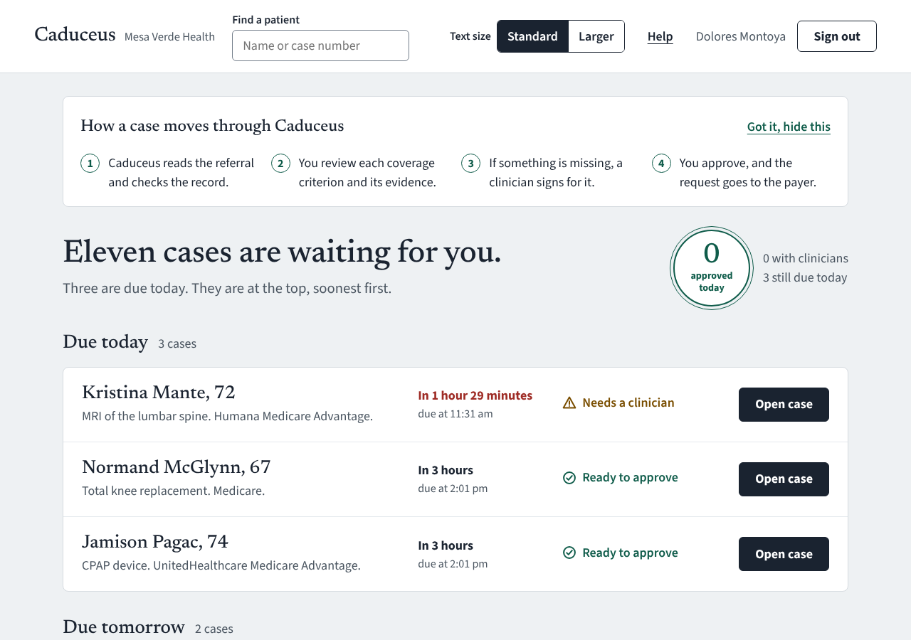
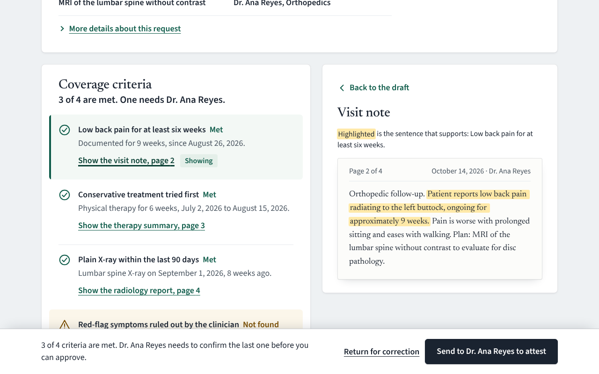
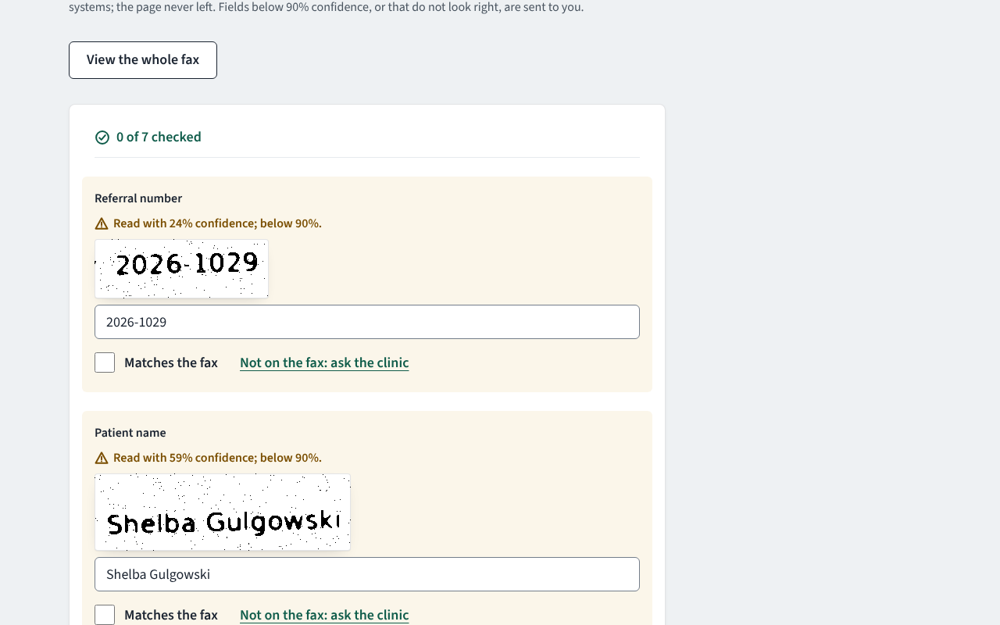
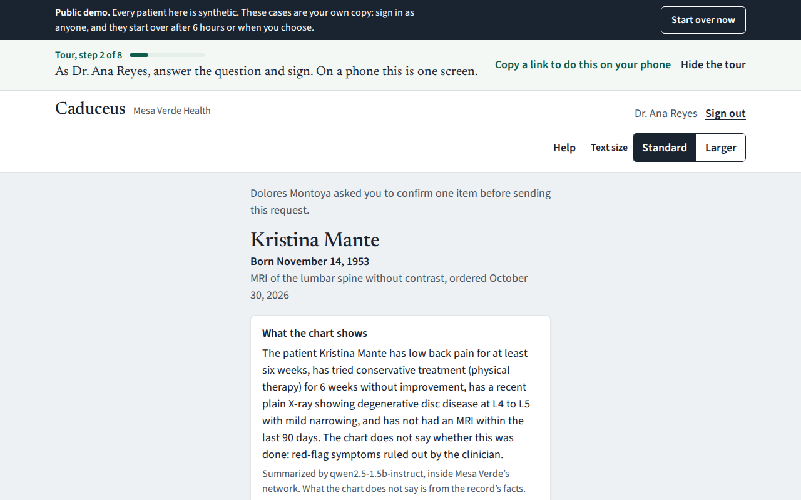
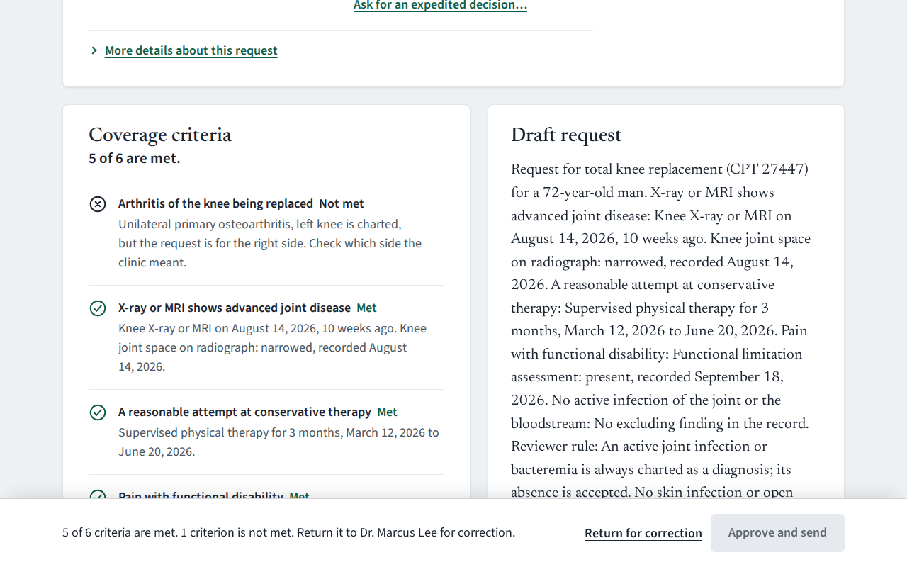
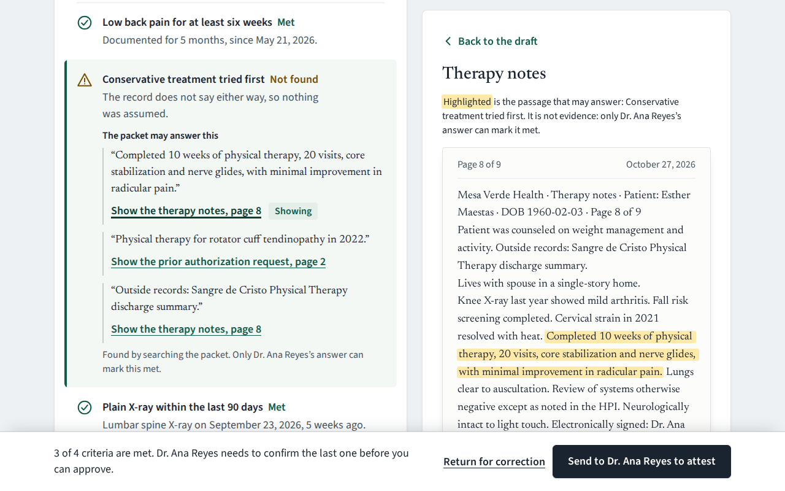
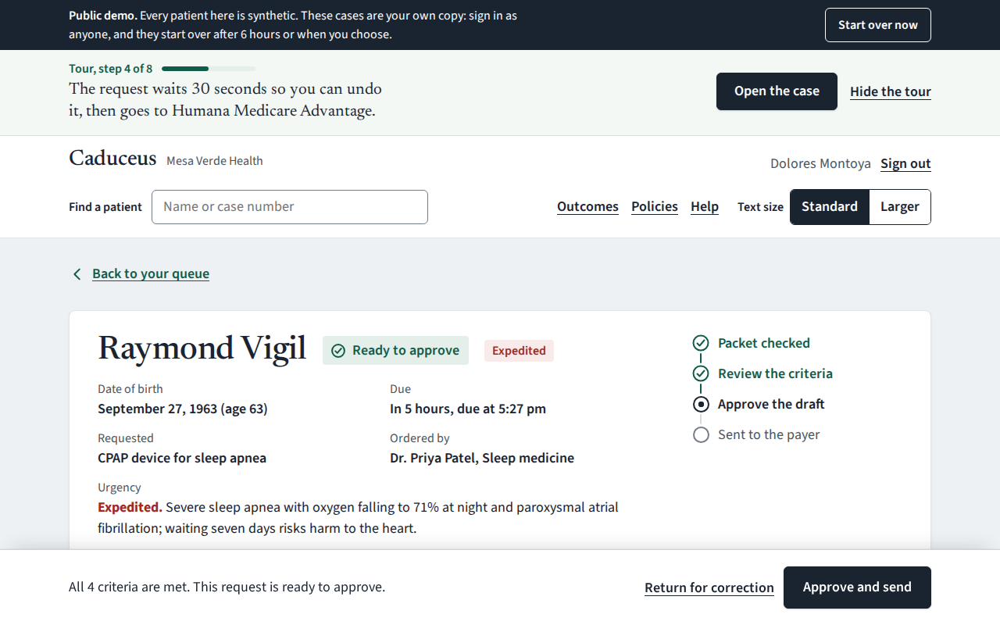
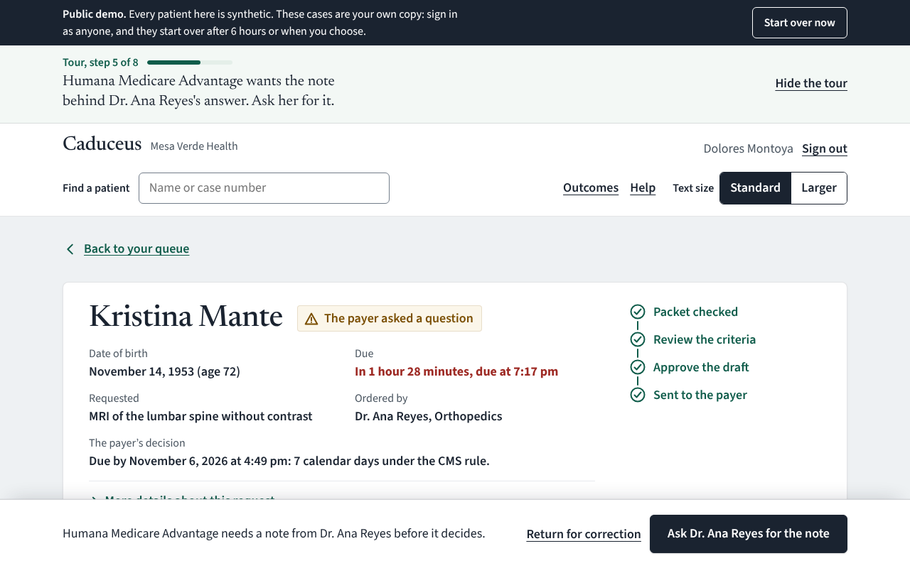
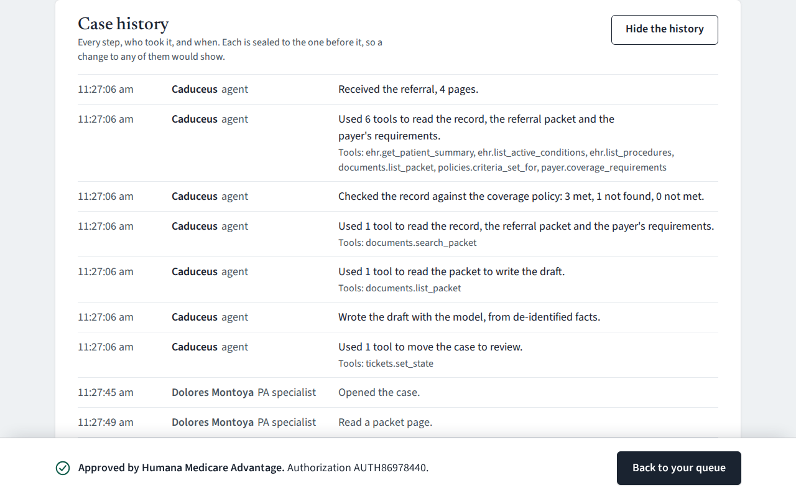

# Caduceus job aid: Review a prior authorization

**For prior authorization specialists and ordering clinicians** · [Open the practice demo](https://caduceusdemo.netlify.app/) · [Facilitator materials](#usability-test-kit)

Use this reference alongside the demo to review a referral, resolve a missing or conflicting detail, and follow the payer’s response. The screenshots show fictional patients in a simulated health system.

## Open the referral and check the record

Begin as Dolores Montoya, the prior authorization specialist. The guided tour uses Kristina Mante’s MRI request. All cases in this job aid use synthetic records.

### 1. Open the guided case

In the tour banner, select Open the case. Check the patient, requested service, and ordering clinician. For this exercise, you should see Kristina Mante, a lumbar MRI, and Dr. Ana Reyes.

### 2. Read the evidence for each criterion

Under Coverage criteria, select Show the visit note, page 2. Read the highlighted sentence beside the criterion it supports. Repeat for the other criteria and locate the one marked Not found.

**If the referral arrived by fax.** From Arrived by fax, select Check the fax. Compare each flagged field with its image, correct the value if needed, then select Matches the fax. If information is missing, choose Not on the fax: ask the clinic. Confirm the patient before creating the case.

## Resolve a missing or conflicting detail

Use the coverage status to choose the next action. A missing answer goes to the ordering clinician. A conflict between the order and chart goes back for correction.

### 3. Send the missing question to the clinician

In Kristina’s case, select Send to Dr. Ana Reyes to attest. Follow the tour to the clinician role. Read What the chart shows, answer the outstanding question from the record, and sign your response. If the record is insufficient, choose No, or I need to check first.

### 4. Return a conflicting order

Separate practice case: open Gilbert Romero’s knee request. Under Coverage criteria, compare the side in the chart with the side requested. Select Return for correction and explain that the chart documents the left knee while the request specifies the right.

**When a packet contains a possible answer.** In Esther Maestas’s MRI case, open the linked therapy notes under The packet may answer this. Use the passage to locate the relevant history. The ordering clinician still needs to confirm it before the criterion can be marked met.

## Submit and follow the payer’s response

Return to the specialist role. Check the case status and the draft before sending. The queue records separate events for approval, submission, and the payer’s decision.

### 5. Review and send a ready request

When all criteria are met, review the draft and select Approve and send. The demo gives you 30 seconds to undo. Check for Sent to the payer before treating the request as submitted. Raymond Vigil’s expedited case illustrates the ready state.

### 6. Respond to a payer question

For Kristina, a payer question asks for the note behind the clinician’s answer. Select Ask Dr. Ana Reyes for the note. In the clinician role, review the request and sign the note if supported. Back as the specialist, review the signed reply and approve it for sending.

**Check the outcome.** Open Case history to see who acted and when. A payer question still needs a reply. For a denial, read the reason and compare the draft appeal with the policy and record before sending. A completed approval displays the payer’s decision and an authorization number.

---

## Usability test kit

A moderated study of Caduceus with the people who would use it: prior authorization specialists at a desk, and
ordering clinicians on a phone. Everything a moderator needs is here: what we want to learn, who to recruit, the
tasks, the script, what to record, and how to turn sessions into fixes. It runs on the public demo, whose patients
are all synthetic, so no session ever shows real patient information.

## What we want to learn

1. Can a specialist tell, for each criterion, whether the record shows it, and trust why?
2. When the record cannot answer, do they find the passage in the packet that may, and do they understand it is
   not evidence until the clinician confirms it?
3. Do they catch a request that is wrong (the other knee), and know what to do next?
4. Can a clinician answer what they are asked on a phone, in under a minute, without opening anything else?
5. Do specialists understand what happens after approval: the 30 seconds to undo, the payer's review, an expedited
   request's 72 hours?
6. Where do people hesitate, misread, or work around the screens?

## Who

- **Five prior authorization specialists**, at least two with under a year in the role. Five finds most problems
  that a task-based study can find; more repeats them.
- **Three ordering clinicians** (or their medical assistants, if they answer these requests in practice), on their
  own phones.
- Recruit through the PA manager. Sessions are 45 minutes for specialists and 20 for clinicians, on work time.
- Nobody is tested on their own speed, and nothing they say is reported by name.

## Setup

- Each participant gets their own copy of the demo: a fresh browser profile, or "Start over now" in the demo banner
  before the session.
- Specialists: a laptop or desktop at the size they use at work, signed in as **Dolores Montoya**. Clinicians:
  their own phone, signed in as **Dr. Ana Reyes**. So both see the same cases, the moderator uses the tour's "Copy
  a link to do this on your phone" and opens that link on the clinician's phone, then chooses "Hide the tour".
- Record the screen and voice only with written consent; recordings are kept for 30 days, then deleted.
- One moderator, one note-taker. The note-taker fills in the observation sheet below, one per task.

## Tasks

Read each scenario aloud, give it on a card, and do not explain the screen. If a participant asks how to do
something, ask what they would expect, then move on after two minutes of no progress (a failure, which is data).

| # | Who | Scenario | Success looks like |
|---|---|---|---|
| 1 | Specialist | "It's the start of your day. Which request needs you first, and what does it need?" | Opens Kristina Mante's case (due soonest); says one criterion is not in the record and Dr. Reyes must confirm it |
| 2 | Specialist | "A referral came in by fax. Check it and get it into the queue." | Opens the fax from Shelba Gulgowski, checks each flagged field against the page, fixes the member ID or asks the clinic, confirms the patient, creates the case |
| 3 | Specialist | "Esther Maestas's MRI request: is everything there? If not, where would you look?" | Finds that conservative care is not in the record; opens the therapy notes passage; says the clinician still has to confirm it; sends it to Dr. Reyes |
| 4 | Specialist | "Gilbert Romero's knee replacement: can this go to the payer?" | Sees the arthritis criterion is not met because the chart documents the left knee and the request is for the right; returns it to Dr. Lee for correction with a reason |
| 5 | Specialist | "Raymond Vigil's CPAP request is marked expedited. What does that change, and is it ready?" | Explains the clinic's reason and the 72-hour clock; approves it; describes what the bar says while it is sending and while the payer reviews it |
| 6 | Clinician | "You got a request to confirm something for Kristina Mante. Deal with it." | Opens it from the list, answers, signs, without leaving the screen or asking what it means |
| 7 | Specialist | "The payer came back on one of your requests. Take it from here." | For a question: asks the clinician for the note, then sends it. For a denial: reads the reason, reads the drafted appeal, sends it |
| 8 | Specialist | "Someone asks you which policy the knee criteria come from. Show them." | Opens Policies; points to LCD L36007, the approval, and the policy's own words for one criterion |

## Script

**Welcome (3 minutes).** "Thank you for helping. We're testing the software, not you; if something's confusing,
that's what we need to know. Everything here is made up, including the patients. Please think aloud: say what
you're looking at, what you expect, and what surprises you. I may not answer questions during a task, and I'll
explain why after. You can stop at any time."

**Before the tasks (2 minutes).** "How do you work a prior authorization today, from the referral to the decision?
What takes the longest? When did a request last go wrong, and how did you find out?"

**Tasks (30 minutes).** For each: read the scenario, start the timer when they begin, stop it at success or two
minutes stuck. After each, ask the single ease question: "Overall, how easy or difficult was that, from 1, very
difficult, to 7, very easy?" Then: "What did you expect to happen when you…?" for anything they hesitated over.

**After the tasks (8 minutes).** The System Usability Scale questionnaire, then: "What would worry you about using
this on real requests? What would you want to see before you trusted a 'met'? What did we leave out that you'd
need on day one? If you could change one thing, what?"

**Close (2 minutes).** Thank them, explain anything they asked during tasks, and stop the recording.

## Observation sheet

One per task, per participant.

| Field | |
|---|---|
| Participant and task | P_, T_ |
| Outcome | Success / success with help / failure |
| Time | mm:ss |
| Ease (1 to 7) | |
| Path taken | Which screens, in order |
| Hesitations | Where they paused more than five seconds, and what they said |
| Misreadings | What they took a word or control to mean, if wrong |
| Errors | Actions they undid or would have regretted |
| Quotes | Their words, verbatim |

## Turning sessions into fixes

1. Within a day of each session, the note-taker writes each problem on its own line: what happened, on which screen,
   for whom, and a quote.
2. After the last session, group the lines into problems, and rate each on this scale:

   | Severity | Meaning |
   |---|---|
   | 4: blocks use | A participant could not finish a task, or would have sent a wrong request |
   | 3: major | They finished only with help, or misread what the screen said about safety (what is evidence, what is sent) |
   | 2: minor | They hesitated or took a long way round, but got there |
   | 1: cosmetic | Noticed, no effect on the task |

3. Every 4 and 3 is fixed before live use and tested again with one new participant. A 2 is fixed if it is cheap,
   or written up for later. Report task success, time and ease per task, and the SUS score, with the number of
   participants beside every figure.

## Measures, and what would worry us

| Measure | Worrying if |
|---|---|
| Task success | Under 4 of 5 specialists on any of tasks 1, 3, 4 or 5 |
| Clinician task time | Over 60 seconds for task 6 |
| Ease | A median under 5 on any task |
| SUS | Under 68, the usual average |
| Safety misreadings | Any participant who believes a passage under "The packet may answer this" already makes a criterion met, or that a request is sent the moment they approve it |
